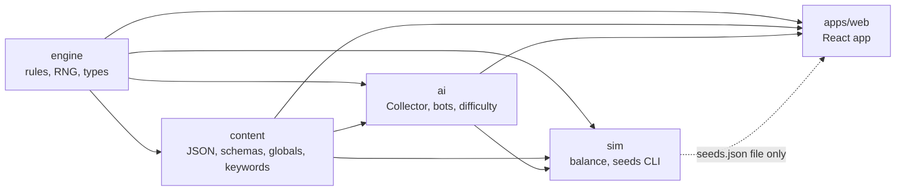
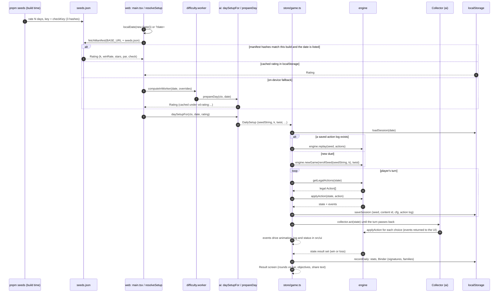
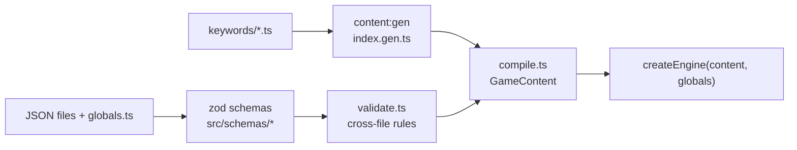
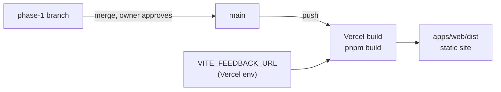

# Vault Duel developer's guide

For a developer joining the project and for the owner. It shows how the pieces fit together and where to
change things. It points to the other docs instead of repeating them. Decision D-257 explains why this file
exists.

| Document | What it is |
| --- | --- |
| `docs/DESIGN.md` | The rules and AI behavior. The source of truth for how the game plays. |
| `docs/ARCHITECTURE.md` | Types, pipelines, hooks, the effect DSL, schemas, RNG, AI, sim and web. Cited below as §N. |
| `docs/CONTENT_GUIDE.md` | How to edit cards, text and globals without touching code. |
| `docs/DECISIONS.md` | The decision log. Every non-obvious choice has a D-number. |
| `docs/CHANGELOG.md` | Owner-facing tooling changes. |

## 1. What the project is

Vault Duel is a once-a-day, single-player card duel for the browser, played on a phone in a few minutes. You
face the Collector, a scripted opponent, on a seed that everyone shares for that calendar day. You summon
monsters, cast spells, set traps, and Graft two cards into a Chimera. Before the last round you must have
Appraised the cards the Collector wants, or he takes them. The engine is a pure function of a seed and an
action log, so a day's duel can be replayed, balanced by simulation and rated for difficulty before it ships.
Read `docs/DESIGN.md` first. It owns every rule.

## 2. Repo layout

pnpm workspace (`pnpm-workspace.yaml`: `packages/*`, `apps/*`). Strict TypeScript everywhere; the workspace
packages export their `.ts` source directly, so Vite and tsx compile them with no build step per package.

| Path | Owns |
| --- | --- |
| `packages/engine` | The rules: state, `applyAction`, `getLegalActions`, hooks, the effect interpreter, RNG, setup, replay and state hashing, `redactState`. No runtime dependencies, no DOM, no Node. Also `test-utils/` (board DSL, fixtures, `TEST_GLOBALS`). |
| `packages/content` | All data: card, recipe, element, twist and objective JSON, `collector.json`, `globals.ts`, the zod schemas, the cross-file validator, the keyword files in `keywords/`, and `compile.ts`, which turns raw content into the engine's `CompiledContent`. |
| `packages/ai` | The Collector policy (`collector/`), the bots used for balance (`bots/`: novice, greedy, expert), and the daily difficulty check (`difficulty.ts`: `prepareDay`, `daySetupFor`, `checkKey`, `expertHash`). |
| `packages/sim` | The Node balance harness: a worker pool of duels, aggregates, reports to `docs/reports/`, and the seeds manifest generator. CLI in `src/cli.ts`. |
| `apps/web` | The React app: Zustand game store, screens, persistence, the offline service worker, and the difficulty web worker. Vite build. |

## 3. Package dependency graph

The arrows below are the real `dependencies` of each `package.json`. `engine` has none, and `content` depends
on `engine` because the compiled-content and globals types live there (§3, §10). So the engine sits at the
root and the data layer sits above it. `docs/ARCHITECTURE.md` §2 and `eslint.config.js` say the same
(`engine ← content ← ai ← sim`), and a lint rule enforces the direction.



`sim` never imports `apps/web`. The only link is a file: `pnpm seeds` writes `apps/web/public/seeds.json`
(a path string in `packages/sim/src/cli.ts`), and the web app reads it over HTTP. For the same reason
`packages/sim/src/seeds.ts` carries its own copy of the manifest parsing rules from
`apps/web/src/daily/manifest.ts` (D-254). Change one and you must change the other. `web` does not import
`sim`.

## 4. A daily duel, end to end

The date is the player's device-local calendar date (`localDate` in `apps/web/src/daily/date.ts`). The seed
string comes from the date. A difficulty rating (`k`, the reroll index, plus stars and par) says which
variant of that seed is used. The rating is expensive to compute, about 7 s on a desktop (D-255), so the
build ships a precomputed manifest and the device computes only when the manifest cannot be used (D-236).



Points worth knowing:

- The player's step and the Collector's whole turn are one `playerStep` in `apps/web/src/duel/runtime.ts`.
  The loop ends when the engine says it is the player's turn or the duel has a result.
- The legal action list is read with `getLegalActions`. The UI and the Collector never invent a move (§6).
  `apps/web/src/view/legal.ts` only groups the list for display.
- The saved record is `{seedString, k, twist, contentVersion, cfg, actions}` (`daily/session.ts`). Resuming
  replays it. A changed content version or `state.cfg` gives "restart with a notice", never a crash.
- Practice (D-247, D-249) replays today's seed unrecorded and keeps its own `vd:practice:<date>` record. It
  never writes stats or the Binder.
- A manifest rating is used only when `contentHash`, `globalsHash` and `expertHash` all match the running
  build (`checkKey`), so a stale `seeds.json` is ignored, not trusted.

## 5. Content pipeline

JSON is the canonical source for cards and numbers since D-166. The files are in `packages/content/`:
`cards/*.json`, `recipes.json`, `elements.json`, `kinds.json`, `twists.json`, `objectives.json`,
`art-briefs.json`, `collector.json`. Numbers live in `packages/content/src/globals.ts` (core globals, feature
flags and `CONTENT_NUMBERS`). Keyword and Flaw behavior is code, one file each, in
`packages/content/keywords/<id>.ts`.



- **Schemas** (§10): zod, strict, in `src/schemas/`. `src/files.ts` parses a raw file set and formats errors
  as `file › entry › problem › fix` lines.
- **Validator** (§10.3): `src/validate.ts` holds the cross-file rules (ids exist, decks have the right size,
  recipes resolve, and so on).
- **`pnpm content:gen`** rewrites `packages/content/keywords/index.gen.ts` from the keyword files. It runs
  before `dev` and `build`.
- **`pnpm content:check`** (`packages/content/scripts/content-check.ts`) runs zod, the validator and the
  deck-generation feasibility check over many dates. It fails the build on any error.
- **Globals** (§11): every number and every mechanic flag is one key in `globals.ts`. Tests do not pin live
  values (D-168), so tuning is one edit and does not break tests.
- Dev hot reload: saving any JSON, `globals.ts` or keyword file reloads content in the browser and restarts the
  duel in progress (D-176).

For the edit loop, error messages and per-task recipes, use `docs/CONTENT_GUIDE.md`. It is tested
(`packages/content/test/guide.test.ts`), so its examples stay true.

## 6. The four runtime packages in brief

**Engine (`packages/engine`, §4 to §9, §12, §18, §19).**
- Public surface: `createEngine(content, globals, services, opts)` returns an object with `newGame`,
  `applyAction`, `getLegalActions`, `replay` and friends (§8.7). Also `hashState`, `replay`, `redactState`,
  `roundOf`, `activeSide`, `pickSignature`, `signatureForSeed` and the seed helpers.
- State is a plain serializable `GameState` with integer instance ids and flat arrays (§4). Updates go through
  a copy-on-write transaction (`tx.ts`), so unchanged parts are shared and nothing is deep-cloned in the hot
  path (§18).
- A turn is a pipeline (§5). Cards and keywords react through named hooks (§8). Spells, traps and keyword
  effects are data run by the effect interpreter in `src/effects/` (§9).
- Events (§7) are the only thing the UI and AI need to learn what happened.
- Randomness is sfc32 seeded from a string hash, with named streams (§12). Wall-clock time and unordered
  iteration are banned by lint (§19).

**AI (`packages/ai`, §13, §14).**
- The Collector is a priority list of rules (`collector/rules/`, registered in `rules/index.ts`), moods driven
  by his life, and an intent policy the engine calls for the telegraphed attack. Rule order, mood overrides and
  parameters come from `collector.json`, not code.
- He sees a redacted view of the state (`collector/view.ts`; the engine also exports `redactState`, §13). A property test
  checks that hidden information cannot change his choice.
- The bots (`bots/`: novice, greedy, expert) exist for balance and for the difficulty check. `expert` weights
  count in `expertHash`, so changing them invalidates the shipped manifest.
- `difficulty.ts` rates a day: `prepareDay` runs the duels, `daySetupFor` turns a stored rating into a
  `DailySetup`, and `checkKey` gives the three hashes that tie a rating to a build.

**Sim (`packages/sim`, §15).**
- A Node CLI that fans duels across worker threads (`pool.ts`), merges the results (`aggregate.ts`) and writes
  a report against the `TARGET_*` globals into `docs/reports/` (`report.ts`).
- `seeds.ts` builds, serializes and inspects the seeds manifest (D-254). Bytes do not depend on the worker
  count.
- `--set KEY=VALUE` overrides a global for one run, which is how balance experiments are tried without edits.
- It imports engine, content and ai only.

**Web (`apps/web`, §16).**
- `src/store/game.ts` is the whole non-visual app: a Zustand vanilla store with injected dependencies, so a
  headless test plays a full duel through the code the browser runs. `src/ui/` is the visual layer and can be
  replaced without touching it.
- `src/duel/runtime.ts` wires the engine to the Collector. `src/daily/` resolves the day (date, manifest,
  rating cache, difficulty worker, session save and resume). `src/persistence/` and `src/meta/` hold stats,
  the Binder and calendar data in `localStorage`. `src/view/` holds pure display helpers (legal-action groups,
  log lines, share text, objectives).
- The offline shell is a service worker written at build time (D-250). Content is bundled in the JS, so the app
  loads offline.
- Two items are being added in a parallel round and are described in section 11: the How to play pages and the
  feedback link.

## 7. Commands

Run from the repo root. Node 24 (`engines.node` is `24.x`); the package manager is pnpm (pinned in `packageManager`).

| Command | What it does |
| --- | --- |
| `pnpm dev` | `content:gen`, then the Vite dev server for `apps/web` with content hot reload. |
| `pnpm test` | `vitest run` over every project. Always from the root (section 8). |
| `pnpm typecheck` | `tsc -b` over all packages. |
| `pnpm lint` | `eslint .` |
| `pnpm content:gen` | Regenerate `packages/content/keywords/index.gen.ts`. |
| `pnpm content:check` | Validate all content and check deck feasibility. |
| `pnpm sim` | The sim CLI with your own arguments, e.g. `pnpm sim quick --games 500`. |
| `pnpm sim:quick` | Quick balance run (`SIM_QUICK_GAMES` games per bot). Writes a report to `docs/reports/`. |
| `pnpm sim:full` | Full balance run (`SIM_FULL_GAMES`). Long. |
| `pnpm sim:seed <YYYY-MM-DD>` | Rate one date and print every candidate `k`. |
| `pnpm seeds --from DATE --days N` | Write `apps/web/public/seeds.json` for N consecutive days. Options: `--workers`, `--out`, `--set`. |
| `pnpm seeds:check` | Warn when `seeds.json` is missing, stale (any of the three hashes) or short of the next 30 days. Always exits 0. |
| `pnpm bench` | `vitest bench packages/engine`. The target is at least 1,000 duels per second per core (§18). |
| `pnpm build` | `content:gen`, `content:check`, `seeds:check`, `tsc -b`, then the Vite build to `apps/web/dist`. |

The sim subcommands take `--games`, `--seed-dates`, `--from`, `--bots`, `--set`, `--workers` and `--out`.
`pnpm sim` without arguments prints the usage text (`packages/sim/src/args.ts`).

## 8. Testing

Run `pnpm test` (or `pnpm exec vitest run <path>`) from the repo root only. `tsc -b` emits compiled copies of
the tests into each package's `dist/`. The root `vitest.config.ts` defines one project per package and
excludes `**/dist/**`. A run started inside a package directory skips that exclusion and counts the compiled
tests a second time.

Where tests live:

| Where | What |
| --- | --- |
| `packages/engine/src/*.test.ts` | Unit and scenario tests next to each module. `properties.test.ts` has the fast-check properties (legal actions never throw, card conservation, replay hash equality, redaction). |
| `packages/content/src/*.test.ts`, `packages/content/test/` | Schemas, validator, compile, keyword examples (generated from each `KeywordDef.examples`), the guide's examples, and the globals-readers tripwire. |
| `packages/ai/test/` | Collector rules, intent, views and redaction, bots, difficulty, performance. |
| `packages/sim/test/` | Args, pool, aggregation, reports, the seeds manifest. |
| `apps/web/test/` | Pure web logic under Node, no DOM: the store, session, manifest, persistence, view helpers. |

The board-state DSL (`packages/engine/test-utils/board-dsl.ts`, syntax in §17 and the header of that file) is
how rule scenarios are written. A scenario is plain text: it declares test-only cards, sets the board, hand,
life and traps for each side, applies actions with `do`, and asserts with `expect`.

```
card raider P gale beast 5/3
turn 6
P board [raider A] [-] [-]
C board [-] [-] [-]
C life 25
do attack P0 > face
expect C life 20
```

Rules for tests (§17, D-168, D-169): a test never hard-codes a live card or a live number. Engine tests use
fixture content and `TEST_GLOBALS`. (Running the properties under a second `ALT_GLOBALS` set, to catch a
hidden constant, is planned in D-168 but not built yet.) The only live-content test checks that the real
content loads, validates and plays.

## 9. Where to change what

| I want to change | Edit | Then |
| --- | --- | --- |
| A card's stats, text, keywords or art brief | `packages/content/cards/*.json` (`art-briefs.json` for art) | `pnpm content:check`; regenerate seeds (section 10). |
| Add or remove a card | The same JSON file, plus `collector.json` for his deck | `pnpm content:check`; regenerate seeds. |
| A number (life, board size, Appraisal round, bonus, targets) | `packages/content/src/globals.ts` | `pnpm test`; regenerate seeds. |
| Turn a mechanic on or off | A flag under `FLAGS` in `globals.ts` | As above. |
| A Collector rule order, mood or parameter | `packages/content/collector.json` (`ai`) | Owner only; log a decision first (D-166). |
| A Collector rule's logic | `packages/ai/src/collector/rules/<rule>.ts`; new rules register in `rules/index.ts`, and their ids in the `AI_PLAY_RULES` / `AI_ATTACK_RULES` enums in `packages/content/src/schemas/collector.ts` | `pnpm test`; regenerate seeds. |
| Bot weights | `packages/ai/src/bots/expert.ts` (`EXPERT_WEIGHTS`) | Regenerate seeds (changes `expertHash`). |
| A new keyword or Flaw | One file `packages/content/keywords/<id>.ts` with `examples`, plus an icon | `pnpm content:gen`, `pnpm content:check`. Tests are generated from the examples. |
| A new effect primitive or hook | `packages/engine/src/effects/` or `src/hooks/` (§8, §9) | Needs a DESIGN rule and a decision first. |
| A rule of the game | `docs/DESIGN.md` first, then the module named in the ARCHITECTURE traceability table | Log a decision. |
| A screen or component | `apps/web/src/ui/*.tsx` (Home, Duel, Result, Stats, Binder, Inspect, Debug) | Styles in `apps/web/src/style/`. |
| What a screen reads | `apps/web/src/store/game.ts` and `apps/web/src/view/*` | Keep logic out of `ui/`. |
| The seeds window | Run `pnpm seeds --from <first date> --days <N>`; the output is `apps/web/public/seeds.json` | Commit the file. |
| The feedback form URL | The `VITE_FEEDBACK_URL` env variable (Vercel project settings, or `apps/web/.env.local` for dev) | No code change. |
| The offline cache rules | `apps/web/src/sw/sw.template.js` and the `offlineShell` plugin in `apps/web/vite.config.ts` | D-250. |
| App icon | `apps/web/public/icon.svg`, then `apps/web/scripts/make-icons.mjs` | D-251. |
| Lint exceptions | `eslint.config.js`, with a reason comment | Never an inline disable. |

## 10. Rules of the road

- **Determinism (§19).** In `packages/engine/src`, `packages/content/keywords` and `packages/ai/src`: no
  `Math.random`, `Date`, timers, DOM, Node APIs, `for...in`, or iteration over object keys whose order could
  change an outcome. Randomness only from the seeded streams (§12). Lint enforces this. The same seed and
  action log must give the same state hash, in the browser and in sim.
- **Engine purity.** `applyAction(state, action)` returns `{ state, events }`. `getLegalActions` is the single
  source of legality for the UI, the AI and the bots. Do not rebuild turn arithmetic locally; use the engine's
  `roundOf`, `activeSide` and `signatureForSeed` (D-256).
- **No `eslint-disable` comments.** If a rule needs an exception, add a scoped block to `eslint.config.js`
  with a comment that gives the reason (see the blocks for `freeze.ts`, `canonical.ts` and the workers).
- **No `any`** in engine or content.
- **Never change a DESIGN rule on your own.** If a rule looks wrong, record a `PROPOSAL, needs owner review`
  entry in `docs/DECISIONS.md` and keep the rule.
- **The decision log.** `docs/DECISIONS.md` entries use a D-number, a date, the question, the decision and the
  reason. The next free number is **D-366**. When DESIGN.md is ambiguous, take the simplest reading and log it.
- **Regenerate `seeds.json` after any change to content, globals or the expert weights (D-255).** Otherwise
  the manifest hashes no longer match, every device falls back to the slow on-device check, and
  `pnpm build` prints a warning. Use `pnpm seeds --from <date> --days 90`. It takes a few minutes on a
  multi-core machine.
- **Dev-only overrides (D-252).** `?set=NAME=VALUE` (repeatable) and `?debug` work in dev builds only. They
  never reach production, and they are also passed to the difficulty worker. `?date=YYYY-MM-DD` overrides the
  daily date.
- **Offline service worker (D-250).** The worker is generated at build, and its cache name hashes the shell
  files, so every build is a new cache. There is no `skipWaiting`: an open tab keeps its old chunks until it
  is reloaded. `seeds.json` is network first, so a new manifest is picked up when online. Test offline
  behavior against a production build (`pnpm build`, then `pnpm --filter web preview`), not `pnpm dev`.
- **Preserve save compatibility.** Session, stats and Binder records carry a version field (`v`). Change a
  shape only with a version bump and a migration or a safe reset.

## 11. Deploy

The setup from D-257, as built (D-264). The code lives in the private GitHub repository
`hassanshirazi-ls/vault-duel`, and the owner's business Vercel account deploys it. Step-by-step import
instructions and the env variables are in the root `README.md`.



- **Config.** `vercel.json` at the repo root sets the install command `pnpm install --frozen-lockfile`, the
  build command `pnpm build` and the output directory `apps/web/dist`. It sends `sw.js` with no-cache,
  `seeds.json` with a 10-minute cache and the hashed `/assets/*` files with a one-year cache, and rewrites paths
  without a file extension to `index.html` (D-263). Node 24 comes from `engines.node`. The Vercel project needs
  the env variable `ENABLE_EXPERIMENTAL_COREPACK=1` so that pnpm comes from `packageManager`.
- **Build.** `pnpm build` runs the content checks and `seeds:check` first. A stale manifest only warns; a
  content error fails the deploy.
- **Feedback link.** The `VITE_FEEDBACK_URL` build variable holds the Tally form URL. When it is unset, the
  link is hidden. The link adds `date`, `seed` and `build` query parameters, which the form reads as hidden
  fields. `build` is the short commit SHA (`VERCEL_GIT_COMMIT_SHA`, else `git rev-parse --short HEAD`, else
  `dev`) plus `CONTENT_VERSION`.
- **How to play.** Five or six illustrated, swipeable pages in the gothic catalogue style (D-240): goal,
  playing cards, combat and elements, Graft, Appraisal, winning. They show on first open and again from the
  "?" on Home. Numbers such as the Appraisal rounds and starting life are read from globals, never typed in.
- **Merging.** The owner merged `phase-1` into `main` for v0.1 (D-264), so production deploys from `main`.
  Merge into `main` only when the owner says so. Nobody pushes to `main` otherwise.
- **Commit author.** Vercel blocks a deploy when the deployed commit's author isn't on the Vercel account or
  team. Commit with an email on the `hassanshirazi-ls` GitHub account (set per clone with
  `git config user.email`).
- **The daily date** stays device-local (`localDate`), so no server clock is involved and there is no backend.
- **Before sharing a link:** run `pnpm test`, `pnpm lint`, `pnpm typecheck` and `pnpm build`; make sure
  `pnpm seeds:check` prints no warning; and check that the manifest window covers the playtest period.
